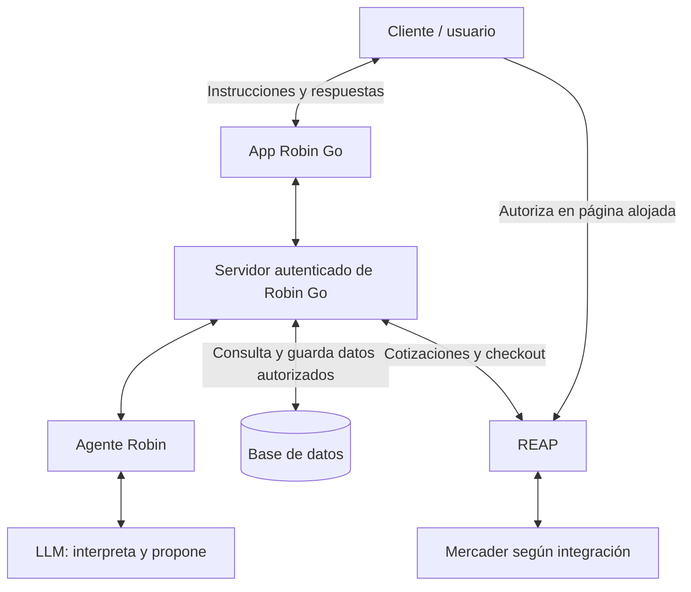

# Flujo de comunicación previsto

[Volver al README](README.md)

1. El usuario expresa su intención.
2. El agente utiliza el LLM para entenderla y preguntar lo que falte.
3. El servidor consulta los datos permitidos y valida presupuesto y políticas.
4. La integración obtiene opciones y prepara una propuesta para revisión.
5. El usuario autoriza el cargo en el flujo alojado de REAP.
6. El servidor consulta el estado confirmado y registra resultado, importe y referencias.

El LLM no accede directamente a las credenciales ni confirma pagos. La redirección no prueba que una compra se completó. El intercambio REAP–mercader depende del contrato y capacidades de la integración elegida.

Este diagrama describe el destino de la integración. Hoy los datos son locales al navegador, los pagos son simulados y el LLM está pendiente de activación.
