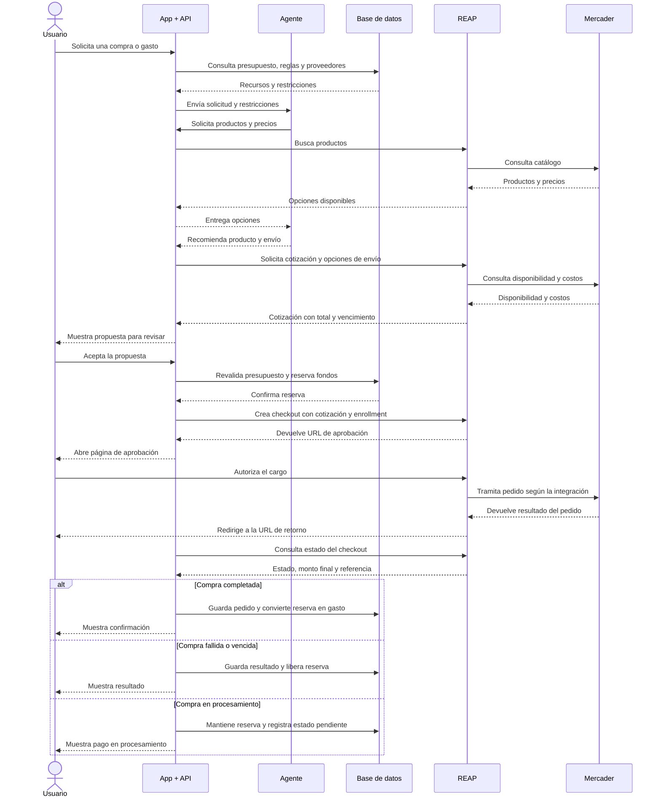

# Robin Go + Katerbot · integración local

Este paquete reúne la interfaz actual de Robin Go en español con el proyecto Next.js/SQL Server del ZIP Katerbot. Conserva la despensa original y añade APIs para los gastos y estados de demostración de Robin Go.

## Estado verificado

- Gastos manuales: API con validación, importes en centavos y edición por identificador.
- Empresa y Compras: guardado de estados de **demostración**, con revisión para detectar conflictos entre pestañas.
- Dos modos preparados: archivo JSON local o SQL Server configurado. No se cae silenciosamente a JSON si falla SQL.
- Migración SQL aditiva: `sql/004_robin_go.sql`.
- Chat: adaptador local preparado, apagado por defecto.
- REAP: simulación por defecto. No se ha verificado ni activado el contrato real del adaptador de Katerbot.
- Pruebas ejecutadas: 6 pruebas de persistencia/validación JSON. Sintaxis JavaScript comprobada.
- Pendiente de ejecutar con el desarrollador: instalación de las dependencias originales, `npm run typecheck`, `npm run build`, pruebas Next completas y pruebas contra una instancia SQL Server. No se instaló software ni se conectó a una base real durante la preparación.

**Uso local de una persona.** Las APIs originales usan un usuario de demostración. El middleware limita las APIs a localhost y valida el origen de las escrituras; esto no reemplaza autenticación ni autorización por empresa.

## Ejecutar

Node.js 20.6 o superior. Instala las dependencias que ya declara el proyecto:

```sh
npm ci
npm run dev
```

- Robin Go: http://127.0.0.1:3000/robin/index.html
- Despensa original: http://127.0.0.1:3000/
- Pruebas nuevas: `npm run test:robin`

Sin conexión SQL configurada se utilizan `data/dev-store.json` (despensa) y `data/robin-store.json` (Robin Go). Estos archivos no se suben a GitHub. No son un sustituto de una base multiusuario. Los dos servidores demo no deben iniciarse sobre el mismo directorio de datos simultáneamente.

## Configurar SQL Server

Copia `.env.example` a `.env.local` y configura `SQLSERVER_CONNECTION_STRING` solo en el servidor. Reinicia Next después de cambiarla.

- **Base vacía:** el desarrollador puede revisar y ejecutar `001_schema.sql` y `002_seed_demo.sql`, y luego `004_robin_go.sql`.
- **Base existente:** haz respaldo, revisa el esquema y ejecuta solo `004_robin_go.sql` en esa base.
- **Nunca repitas `001_schema.sql` sobre datos que quieras conservar:** borra y recrea tablas.

La configuración SQL no migra automáticamente los archivos JSON ni los registros IndexedDB del sitio publicado. Se debe planificar una importación con validación y respaldo si existen datos que conservar.

## Guías

- [Cambios y tareas de integración](INTEGRACION_ROBIN_KATERBOT.md)
- [Desarrollador](GUIA_DESARROLLADOR.md)
- [Propietaria y REAP](GUIA_PROPIETARIA_REAP.md)
- [Flujo de comunicación](FLUJO_INTEGRACION.md)
- [Documentación original de Katerbot](README_KATERBOT_ORIGINAL.md)

Las guías generales describen la arquitectura prevista. Para las rutas y el estado específico de **este paquete** usa `INTEGRACION_ROBIN_KATERBOT.md`.

## GitHub

Sube el contenido de este paquete a una rama de integración, por ejemplo `codex/robin-katerbot`. Este proyecto se ejecuta como aplicación Next.js; no lo publiques en GitHub Pages como si fuera HTML estático. No reemplaces sin revisión la raíz del repositorio de la app estática existente.

Incluye `src/`, `public/`, `sql/`, `tests/`, configuraciones, `package.json`, `package-lock.json` y las guías. Excluye `.env.local`, `.env`, `data/`, `node_modules/` y `.next/`. Solo `.env.example` contiene variables vacías de referencia.


# Flujo de integración: usuario, agente, REAP y mercader

## Estado actual

La aplicación funciona como demo. Los gastos se guardan en el navegador mediante IndexedDB. La base de datos compartida y los pagos reales con REAP están pendientes de integración.

## Arquitectura propuesta

La API de la aplicación coordina al agente, consulta los presupuestos y guarda los resultados. Las credenciales permanecen en el servidor.

El agente propone acciones. El usuario autoriza el pago en la página de aprobación proporcionada por REAP.



## Reglas de integración

- El servidor valida los presupuestos y permisos antes de crear el checkout.
- La cotización debe seguir vigente y corresponder a lo revisado por el usuario.
- El enrollment debe estar activo antes de crear el checkout.
- Regresar a la app no demuestra que el pago se completó: el servidor consulta su estado en REAP.
- Las operaciones deben evitar cobros duplicados mediante claves de idempotencia.
- La app y el agente no reciben ni almacenan los datos completos de la tarjeta.
- La conciliación contable vincula el pago confirmado con su factura o comprobante.

## Pendientes

1. Implementar la base de datos local y el servidor de la aplicación.
2. Definir autenticación y permisos por empresa.
3. Conectar el agente a la API.
4. Configurar las credenciales de prueba de REAP en el servidor.
5. Validar el flujo con el entorno sandbox.

El intercambio entre REAP y el mercader es conceptual y debe ajustarse al contrato de la integración elegida.
