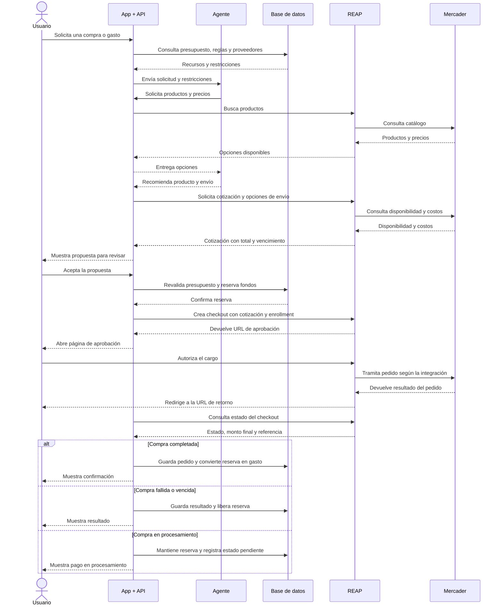

# Robin Go

Robin es el agente de Robin Go para Empresa, Compras y Día a día. REAP es el proveedor de pagos previsto.

## Documentación

| Archivo | Para quién / contenido |
|---|---|
| [Guía del desarrollador](GUIA_DESARROLLADOR.md) | Arquitectura, ejecución local y trabajo pendiente |
| [Guía para la propietaria](GUIA_PROPIETARIA_REAP.md) | Qué solicitar a REAP y cómo coordinar las pruebas |
| [Integración REAP](REAP_INTEGRATION.md) | Configuración, límites y flujo preparado |
| [Cliente REAP del servidor](server/reap-client.mjs) | Código del adaptador; no es una API desplegada |
| [Configuración de ejemplo](.env.example) | Variables sin credenciales |
| [Chat de Robin](ROBIN_CHAT.md) | Servidor local, historial y activación posterior del LLM |
| [Base de datos](DATABASE.md) | Guardado actual y conexión compartida pendiente |
| [Flujo de comunicación](FLUJO_INTEGRACION.md) | Diagrama de la arquitectura prevista |

## Estado real

- La interfaz y la demo guiada están implementadas, con tema oscuro uniforme y textos en español.
- El acceso «Ajustar y revisar en Empresa» abre directamente el panel del plan.
- Incluye el código actualizado y las guías separadas en un mismo paquete.
- Los gastos manuales se guardan en IndexedDB de cada navegador.
- Chat con IA tiene conexión preparada, desactivada por defecto.
- No hay base SQL compartida ni pagos REAP reales conectados.
- El servidor local incluido no tiene autenticación para uso público y no debe exponerse a Internet.

## Ejecutar localmente

Requiere Node.js 20.6 o superior. Desde esta carpeta:

```sh
npm run start:local
```

Abre http://127.0.0.1:4173. No requiere instalar dependencias. Para comprobar la lógica:

```sh
npm test
```

## Subir a GitHub

Descomprime el paquete y sube su contenido al repositorio. Conserva `.gitignore` y `.env.example`. No subas `.env`, claves ni datos de tarjetas. Esta copia no incluye credenciales ni la configuración de despliegue del sitio existente.


# Flujo de integración: usuario, agente, REAP y mercader

## Estado actual

La aplicación funciona como demo. Los gastos se guardan en el navegador mediante IndexedDB. La base de datos compartida y los pagos reales con REAP están pendientes de integración.

## Arquitectura propuesta

La API de la aplicación coordina al agente, consulta los presupuestos y guarda los resultados. Las credenciales permanecen en el servidor.

El agente propone acciones. El usuario autoriza el pago en la página de aprobación proporcionada por REAP.



## Reglas de integración

- El servidor valida los presupuestos y permisos antes de crear el checkout.
- La cotización debe seguir vigente y corresponder a lo revisado por el usuario.
- El enrollment debe estar activo antes de crear el checkout.
- Regresar a la app no demuestra que el pago se completó: el servidor consulta su estado en REAP.
- Las operaciones deben evitar cobros duplicados mediante claves de idempotencia.
- La app y el agente no reciben ni almacenan los datos completos de la tarjeta.
- La conciliación contable vincula el pago confirmado con su factura o comprobante.

## Pendientes

1. Implementar la base de datos local y el servidor de la aplicación.
2. Definir autenticación y permisos por empresa.
3. Conectar el agente a la API.
4. Configurar las credenciales de prueba de REAP en el servidor.
5. Validar el flujo con el entorno sandbox.

El intercambio entre REAP y el mercader es conceptual y debe ajustarse al contrato de la integración elegida.
